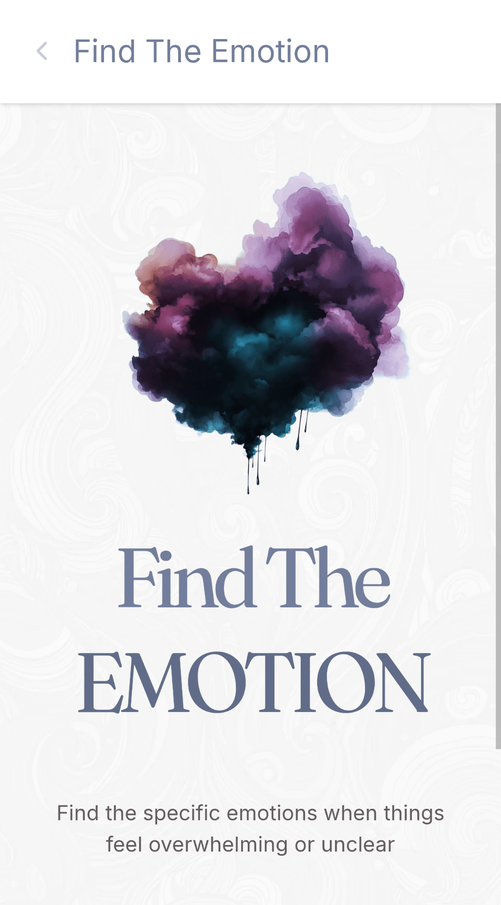
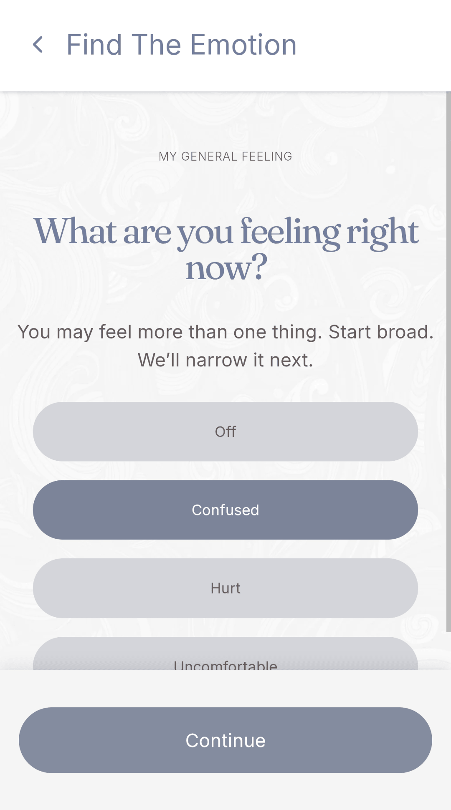
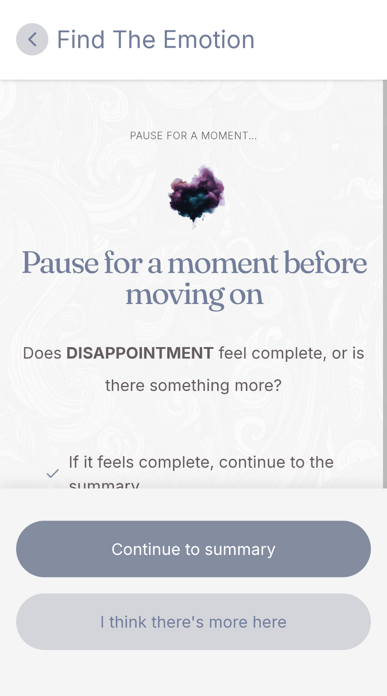

# Find the Emotion

A simple tool to help you identify what you’re really feeling.

Live Demo: [https://idannissimbaraness.com/find-the-emotion/app](https://idannissimbaraness.com/find-the-emotion/app)

## What it is

`Find the Emotion` is a focused tool for identifying what you’re feeling when it’s not immediately clear.

## Why this exists

When emotions feel unclear, it’s hard to know what you’re actually dealing with.

Naming what you feel doesn’t solve it, but it gives you clarity.

And that clarity helps you see what you’re reacting to, instead of staying stuck in a vague feeling.

## Core idea

- What we feel is often a mix, not a single emotion.  
- Clarity comes from noticing what stands out.  
- There is no need to be precise or “get it right”.  
- If it doesn’t feel complete, you can go back and explore further.  
- The process follows you, not the other way around.

## How it works

- You start by selecting what feels true right now.  
- You narrow it down to what stands out most.  
- You pause and check if it feels complete.  
- If it doesn’t, you can look back and explore what came before.  
- This can repeat, forming a clearer understanding over time.

## Architecture

The app is built around a simple but structured flow model:

- **Pass-based model**  
  Each interaction is a “pass.” Users can create multiple passes to revisit and refine their understanding, while preserving prior context unless later passes are intentionally pruned after upstream edits.


- **Custom navigation stack**  
  Navigation is managed by a custom flow stack synchronized with browser history state (not route-based navigation alone). This enables safe backtracking, editing earlier steps, and pruning/discarding future steps when upstream choices change.


- **Normalization layer**  
  Pass content is automatically normalized on every pass-content update (and on session restore). Strong emotions must be a subset of selected emotions, and the dominant emotion must belong to the strong set. This enforces valid state at write-time instead of patching inconsistencies later.


- **Session persistence**  
  Flow state is persisted in sessionStorage, and navigation stack state is synchronized via browser history.state, so a refresh can restore in-progress progress.


### Code structure

- `src/pages` – page-level components  
- `src/components` – reusable UI elements  
- `src/navigation` – navigation stack and flow logic  
- `src/state` – reducer and state management  
- `src/config` – domain data and mappings  

## Tech stack

- React + TypeScript
- Vite
- Tailwind CSS
- Motion (`motion`)
- Lucide React icons

## Getting started

### Prerequisites

- Node.js `24.x`
- npm `11.6.x`

### Install

```bash
npm ci
```

### Run locally

```bash
npm run dev
```

### Build

```bash
npm run build
```

### Preview production build

```bash
npm run preview
```

## Screenshots





## Notes

- Environment secrets should live in `.env.local` (ignored by git).
- The app is intentionally minimal and focused on clarity, not analysis or solutions.

